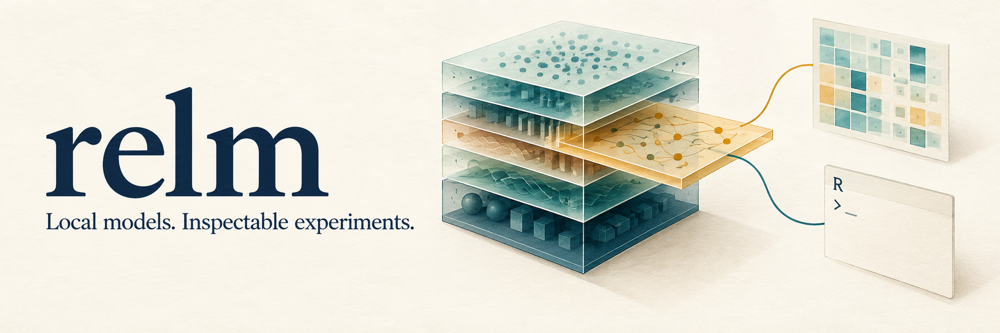
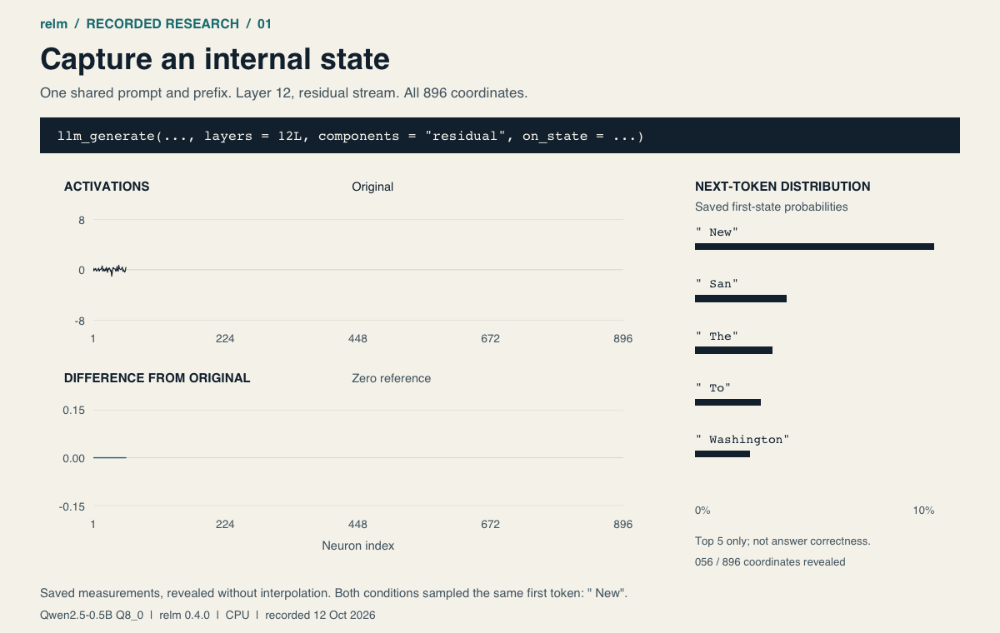
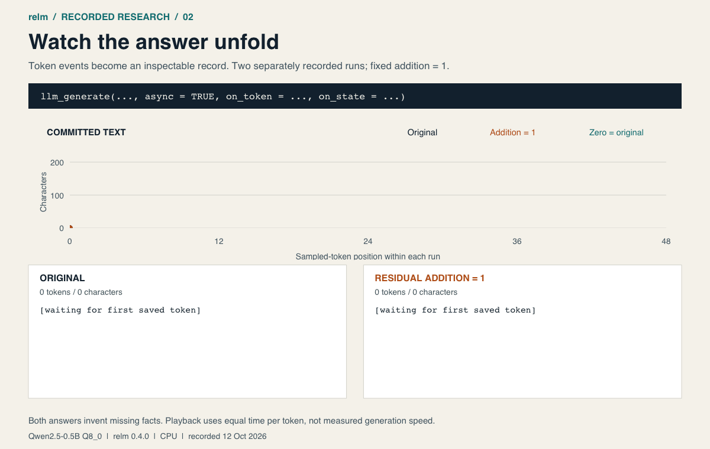

# relm · Local model research in R



[Get started](docs/getting-started.md) ·
[Research walkthrough](examples/research-workflow/README.md) ·
[Documentation](docs/README.md) ·
[0.4.0 release](https://github.com/Vadale/R-ebirth/releases/tag/v0.4.0)

**Run a local language model, inspect its internal activity, and test interventions
from an ordinary R session.** relm returns text, data frames and matrices that
work with the statistical and plotting tools you already use.

R-ebirth is the repository; **relm** is the R package. It embeds a Rust/llama.cpp
engine and runs on stock R ≥ 4.5. No Python runtime, model server or API key is
required. Once a model is downloaded, inference runs locally.

## From a question to an inspectable experiment

**Load → observe → compare → intervene → evaluate → export**

| What you want to do | Start here | What you get |
| --- | --- | --- |
| Generate text or constrained JSON | `llm_generate()` | Text, with streaming and asynchronous options |
| Represent documents numerically | `llm_embed()` | A numeric matrix, one row per input |
| Inspect values inside the model | `llm_trace()` | Selected activations as a data frame or matrix slice |
| Measure whether activations predict a label | `llm_probe()` | Grouped statistical probes with held-out evaluation options |
| Test a controlled intervention | `llm_direction()`, `llm_apply_direction()`, `llm_ablate()` | Derived model handles; the original remains available |
| Inspect and share the experiment | `plot()`, `llm_compare()`, `llm_timeline()` | Base-R figures and exportable tables |

An **activation** is a numerical value inside the model. A **direction** combines
paired activation differences into a reusable vector. An intervention changes
selected values during generation so you can study what changes in the output.
These tools support experiments; a changed activation or shorter answer does
not establish an improvement.

## See an intervention, coordinate by coordinate



*Real values from a saved relm experiment: capture a state, check the zero control,
then compare an intervention at the same prompt and prefix. The animation reveals
recorded coordinates; it does not interpolate new measurements.*

[Play the video](docs/media/research/activation-intervention.mp4) ·
[Static figure](docs/media/research/activation-intervention.png) ·
[How it works and the rendering code](docs/animated-research.md)

## Install and try it

[r-universe](https://vadale.r-universe.dev/relm) distributes the package. Prebuilt
binaries need no Rust or C++ toolchain. macOS arm64 and Linux are the supported
routes. The development source also has an optional [Linux CUDA build](docs/linux-cuda.md)
with measured RTX 2060 results; published 0.4.0 binaries are not certified CUDA builds.
Windows validation remains pending.

```r
install.packages(
  "relm",
  repos = c("https://vadale.r-universe.dev", getOption("repos"))
)
```

The first model download below is approximately 675 MB; later calls reuse the
verified cached file. This small model is useful for learning the workflow,
but its answers still need checking.

```r
library(relm)

path <- llm_download("qwen2.5-0.5b-instruct-q8_0")
m <- llm(path, backend = "cpu", context_length = 512L)

prompt <- paste0(
  "Question: A sealed envelope has no markings. ",
  "Which city is named in the letter inside?\nAnswer:"
)
answer <- llm_generate(m, prompt, chat = FALSE, max_tokens = 48L,
                       temperature = 0, seed = 3107L)
cat(answer)

trace <- llm_trace(m, prompt, layers = 12L, positions = "last",
                   components = "residual", spill = FALSE)
activations <- as.matrix(trace, layer = 12L)
dim(activations) # one captured position × the model's hidden width

close(m)
```

`chat = FALSE` continues the supplied text; `chat = TRUE` uses the model's chat
template. `llm_trace()` observes a forward pass over the supplied prompt, not
the generated answer. Use `on_state` for observations during generation.
CPU makes this example explicit; the normal `backend = "auto"` selects Metal
on supported Apple silicon builds, then available compiled CUDA, then CPU.
See [installation and troubleshooting](docs/getting-started.md).

## Go beyond the first call

- **Run a complete experiment:** the [research walkthrough](examples/research-workflow/README.md)
  saves prompts, fixed conditions, original/zero/intervention outputs, provenance,
  comparison plots and CSV/RDS files. The [research guide](docs/research-guide.md)
  explains which API to use at each step.
- **Watch generation:** [stream token events](rebirth/vignettes/token-streaming.qmd)
  or inspect [live states and intervention graphics](rebirth/vignettes/model-interventions.qmd).
  Async/live generation uses optional `later` and `promises`.
- **Construct an intervention:** [record contrast directions](rebirth/vignettes/contrast-directions.qmd)
  and apply residual addition or component projection on supported sites.
  Projection is static; live coefficient updates are additive.
- **Use the wider R ecosystem:** [probe activations](rebirth/vignettes/anatomy-lab.qmd),
  build a [topic map](rebirth/vignettes/topics-without-python.qmd), or use supported
  [image/text models](rebirth/vignettes/vision.qmd).
- **Build a repeatable application:** separate [batch](examples/funding-extraction/README.md)
  and [local-service](examples/funding-service/README.md) templates preserve jobs
  and results. Valid JSON does not guarantee correct extracted facts.

## Watch generation and keep the evidence



*Actual `on_token` events from the [first-use study](docs/research-first-use.md),
replayed at an equal interval per token. This is not a speed comparison. The
intervention changed the response; both responses still invented missing facts.
relm makes that difference inspectable, so an experiment can test whether a change
helps rather than assume it does.*

[Play the video](docs/media/research/token-stream.mp4) ·
[Static figure](docs/media/research/token-stream.png) ·
[Data, code and interpretation](docs/animated-research.md)

## What works today—and what needs care

Version **0.4.0 is published**, including a verified installation from r-universe
on Mac arm64. The [release record](docs/release-0.4.0.md) separates package checks,
distribution checks and the scope of actual model tests.

- **Supported combinations matter.** Model architecture, component and backend
  support vary. Start with the [support matrix](docs/supported-workflow.md).
  Linux CUDA has a [recorded development scope and performance report](docs/wp13-linux-cuda-implementation.md).
  Windows and vision-encoder tracing remain outside that acceptance.
- **Memory is part of experiment design.** Select layers and token positions.
  Trace spill manages capture storage; it does not bound all model/process memory.
  Close model and derived handles when finished.
- **Interpret changes cautiously.** Probes measure predictive decodability;
  model maps show configuration; interventions provide no safety or debiasing
  guarantee. Numerical checks have [documented scopes and limits](docs/validation-status.md).
- **Functionality and research quality are separate.** Small-model examples and
  a successful workflow do not demonstrate general task accuracy. The
  [first-use assessment](docs/research-first-use.md) records an agent's actual
  experience, including poor outputs and remaining usability gaps. Human
  external-user validation is still open.

## Contribute or explore

Start with the [documentation index](docs/README.md). The package lives in
`rebirth/`; runnable studies and application templates live in `examples/` and
`tests/demos/`. The [development workflow](docs/development-workflow.md),
[architecture](ARCHITECTURE.md) and [simplifier compendium](docs/simplifier-compendium.md)
explain how to contribute and keep changes readable. The optional
[statistical-assistant companion](integrations/README.md) is separate from relm.

Original code is **MIT OR Apache-2.0** ([license](LICENSE.md)); vendored llama.cpp
is MIT ([notice](NOTICE)). Modified redistributions must follow the
[trademark policy](TRADEMARK.md). The cover is a conceptual illustration;
research figures are identified by their actual data source.
