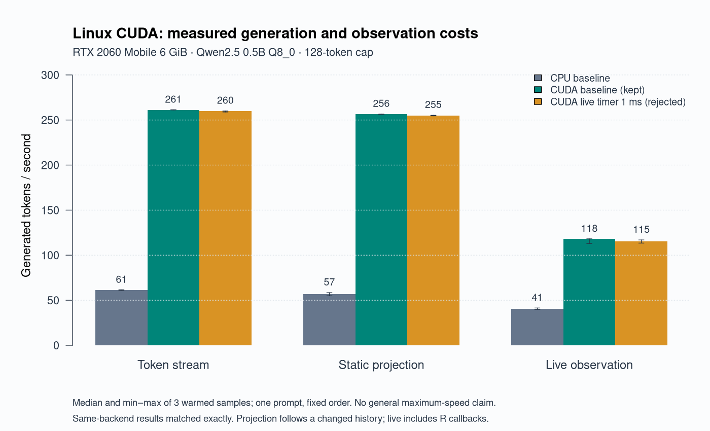

# Linux CUDA: installation and measured scope

The development source now supports optional CUDA on **Linux x86_64**. Local
acceptance used an RTX 2060 Mobile (6 GiB, sm75), driver 580.178.04, CUDA 13.3.1,
GCC 15.3.0, Rust 1.99.1 and R 4.6.1. This is a source-build route; the published
0.4.0 assets and ordinary r-universe binaries are not newly certified CUDA builds.
Windows CUDA, multiple GPUs, other GPU architectures and vision on CUDA were not
accepted by this work. Ordinary CPU/Metal builds remain independent of the SDK.

## Build explicitly

Start from the repository checkout containing this change, with the ordinary
[source prerequisites](getting-started.md#install-from-source), the existing R
package dependencies and a compatible NVIDIA toolkit/compiler/driver installed.
The following shell example records the settings used on the tested sm75 host;
change paths and architecture for your own hardware rather than copying an
architecture setting for a different GPU.

```sh
export RELM_ENABLE_CUDA=1
export CUDA_PATH=/path/to/cuda-13.3.1
export CUDAARCHS=75-real
export CUDACXX="$CUDA_PATH/bin/nvcc"
export CUDAHOSTCXX=/usr/bin/g++-15
export CC=/usr/bin/gcc-15
export CXX=/usr/bin/g++-15
export CARGO_BUILD_JOBS=2
export CMAKE_BUILD_PARALLEL_LEVEL=2
export TMPDIR=/path/to/disk-backed/tmp
mkdir -p "$TMPDIR" /path/to/relm-cuda-library
R CMD INSTALL --library=/path/to/relm-cuda-library rebirth
```

`CUDA_PATH` must contain `bin/nvcc` and shared `libcudart.so`/`libcublas.so` under
`lib64`, `lib` or `targets/x86_64-linux/lib`. The real system driver supplies
`libcuda`; do not put the toolkit's stub-driver directory on the runtime path.
The configured R shared library records the toolkit library path as an rpath;
keep that toolkit installation in place. The verified package loads without
`LD_LIBRARY_PATH`. A GPU and driver are required to exercise CUDA, even if a
machine can compile the package without using one.

The first optimized native build takes substantial time and temporary space.
Use a disk-backed temporary directory with sufficient *user quota*, not just free
space reported by `df`. The actual build exposed a tmpfs quota failure and a CUDA
PIC link defect; both are diagnosed in the [implementation report](wp13-linux-cuda-implementation.md).
CUDA objects now use PIC, and wrapper generation reuses the library's release
profile/flags. Do not change drivers or install another toolchain merely because
GPU access fails inside a sandbox; check actual host access first.

Leave `RELM_ENABLE_CUDA` unset (or0) for the ordinary build. Enabling it on an
unsupported platform fails explicitly. This adds no required R/Rust dependency
and no public API. The version string alone does not identify a CUDA build.

## Use the installed backend

In a fresh R process, with an existing pinned model file:

```r
.libPaths(c("/path/to/relm-cuda-library", .libPaths()))
library(relm)
m <- llm("/path/to/qwen2.5-0.5b-instruct-q8_0.gguf",
         backend = "cuda", context_length = 512L)
m$backend
text <- llm_generate(m, "Describe a simple filing system.", chat = FALSE,
                     max_tokens = 32L, temperature = 0, seed = 17L)
trace <- llm_trace(m, "Describe a simple filing system.", layers = 12L,
                   positions = "last", components = "mlp_out", spill = FALSE)
close(m)
```

Requesting an unavailable backend raises `relm_error_backend`. `backend="auto"`
chooses an available compiled Metal backend first, then CUDA, then CPU; this is
a priority rule, not runtime benchmarking. Request the backend explicitly when
comparing measurements. The public `gpu_layers` parameter remains available;
default full offload does not mean every tensor/operator resides on the GPU.
The recorded Qwen run offloaded25/25 layers but retained 137.94 MiB of CPU-mapped
weights and host buffers. A handle's metadata records the resolved backend;
actual layer/buffer placement was checked independently in native logs.

The [research walkthrough](../examples/research-workflow/README.md) accepts
`backend="cuda"` while keeping CPU as its default. Filtered traces, directions,
static projection, async streams and live observation were exercised using
ordinary R outputs. Projection supports the recorded dense Llama attention/MLP
and dense Qwen2 MLP sites. It admits the registered default CUDA device buffer,
uses synchronous copies into the existing budgeted row and preserves the
scheduler barrier; split/foreign buffer types are not a general GPU extension.

## Performance and practical choices



On the single fixed Qwen 0.5B Q8_0 prompt, warmed median ordinary decode throughput
was **261.18 tokens/s CUDA versus 61.07 CPU (4.28x)**. Whole streamed-call wall time was
0.514s versus2.499s (4.86x). These are three measured repetitions after one warmup,
with identical declared settings; they are not model-quality or maximum-speed
claims. The [full table, raw results and caveats](wp13-linux-cuda-implementation.md#bounded-performance)
include capture/projection/live costs, memory and all slower candidate outcomes.

Keep live callbacks short and select only the layers/components needed.
Observation requires copying data and waiting for R; its cost is real. The tested
1 ms polling candidate was 2.06% slower in median live wall time and used 13.17% more
processCPU than the existing 5 ms timer, so it was rejected. No polling change,
precision change, new cache policy or vendor kernel modification was adopted.
Do not treat faster animation playback, shorter answers or different models as
equivalent performance comparisons.
