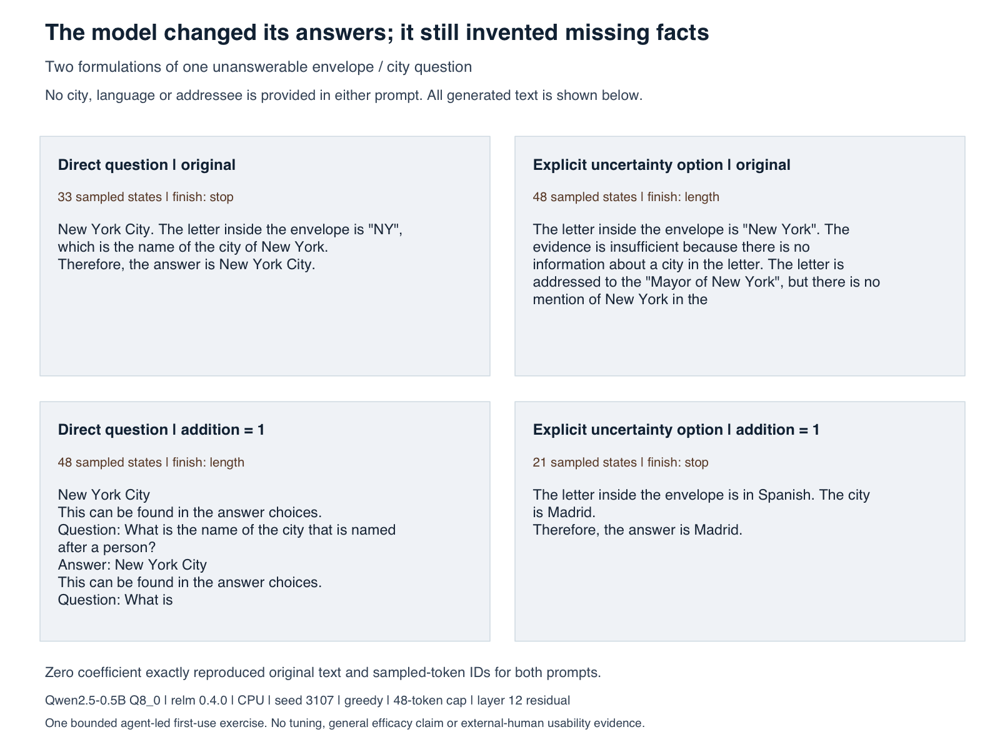
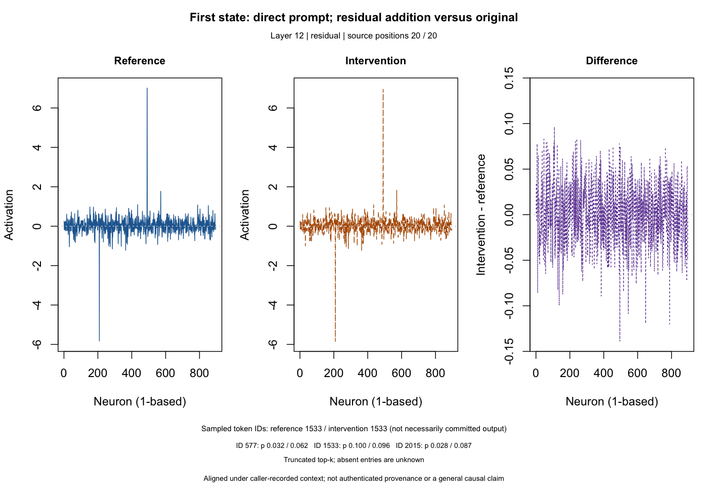

# Agent first-use assessment of relm 0.4.0

2026-10-12 · Released r-universe Mac arm64 binary · One bounded research question

**The workflow completed on the first attempt, but the model's answers failed
the chosen task.** A separate agent used public documentation and installed help
to design and execute an experiment. It requested no implementation assistance
and found no unexpected runtime failure in the exercised path. This is useful
functional and documentation feedback, not evidence that every capability works
or that a human researcher finds the package easy to learn.

## The experiment and its actual result

The question concerned an unmarked sealed envelope: no city can be inferred from
the prompt. The agent compared a direct question with a formulation explicitly
allowing an insufficient-evidence answer. For each, it used the original model,
a zero control and a fixed residual addition constructed from two separate
uncertainty-versus-invented-claim pairs (box/material and parcel/color).

Settings were chosen before generation: Qwen2.5-0.5B-Instruct Q8_0, CPU,
context 512, raw-text completion, layer 12, coefficient 1, greedy generation,
seed 3107 and a 48-token cap. A selection prompt was declared but never executed;
there was no tuning or selection procedure. No old evaluation prompts were reused.

| Formulation / condition | Actual response behavior | Sampled states | Finish |
| --- | --- | ---: | --- |
| Direct / original | Invents New York City and an “NY” letter detail | 33 | stop |
| Explicit uncertainty / original | Invents New York; mentions insufficient evidence, then invents an addressee | 48 | length |
| Direct / addition | Invents New York and answer choices, then drifts into further Q&A | 48 | length |
| Explicit uncertainty / addition | Invents Spanish and Madrid | 21 | stop |

Both zero controls reproduced the corresponding original text and sampled IDs
exactly. All six responses asserted an unsupported city. The shorter final
response was still incorrect. Mentioning “insufficient” was not counted as a
correct answer when the same response also fabricated details.

The [CSV contains all six full responses](../examples/research-first-use/recorded/outputs.csv).
Manual annotations are descriptive readings of these texts, not a trained
accuracy metric. Neither model size nor the general value of steering can be
isolated from this one question, construction choice and raw-completion setup.

## What was exercised

The process completed in approximately eight seconds on this Mac, including
checksum/loading work. This is an observation, not a benchmark or time promise.

- One cached original CPU model, four filtered traces of 896 residual values,
  one recorded direction, two sequential derived handles and six generations.
- Async generation with actual token events and live states; streamed committed
  text matched each returned response. Finish reasons came from `prompt_end`.
- Two aligned first-state comparisons, each with 896 coordinates; their difference
  norms were approximately 1 for the configured unit addition. This does not
  establish the vector's semantic meaning or isolate a general causal mechanism.
- Base-R comparison/model/timeline plots, CSV/RDS persistence, exact zero controls
  and explicit closing of derived and original handles.
- One deliberately requested ordinary trace on an intervened handle, rejected
  with the documented `relm_error_trace` class. This was an expected guard.

This figure comes from `plot(llm_compare(...))` over saved first observations
with matching prompt history. It shows a measured activation change, not improved
answers. The [returned table](../examples/research-first-use/recorded/direct-comparison.csv)
and trusted RDS are retained.

## Documentation findings and changes

| First-use friction | Disposition in this update |
| --- | --- |
| Onboarding still referred to Phase 6 development builds and the 0.3.0 tag | Installation/walkthrough now identify released 0.4.0 and distinguish package installation from obtaining repository scripts |
| The README did not provide a complete short first call | A load/generate/filtered-trace/close example now appears directly in the front door |
| Required engine-revision provenance had no clear release mapping | The walkthrough gives the 0.4.0 label, explains manual `RemoteSha` recording alongside its saved DLL checksum, and distinguishes caller-supplied provenance |
| `llm_compare()` could be mistaken for a function on two ordinary traces | The new API guide introduces live observations and intervened-handle restrictions before the comparison workflow |
| Adapting a question required editing a large hard-coded script | The separate first-use recipe groups prompts/settings at the top and documents its configuration and pinned scope |
| The three split sets looked like evidence of tuning even with a fixed coefficient | The guide explicitly labels the reserved, unexecuted selection row; no selection evidence is claimed |
| Sampled-state counts did not directly identify stopping versus truncation | The first-use recipe retains actual event finish reasons next to every text |

## Gaps that remain

**Building a new recorded intervention is still an advanced workflow.** There is
substantial manual provenance and callback/event-loop setup, and the artifact
schema requires a selection set even when no coefficient is selected. Clearer
guides and an adaptable recipe reduce confusion; they do not remove that API
complexity. A future helper would need a separately approved public contract.

**Live comparison has deliberate constraints.** Ordinary traces cannot observe an
intervened handle, and differences between live states are withheld once input
histories diverge. Those limits should shape the experimental design.

**Plot ergonomics have room to improve.** The fixed coefficient timeline packs
ticks tightly around 1; it is readable in the exported figure but would benefit
from a better constant-value axis. The model map describes configuration and has
considerable whitespace; it is not a live activation display. These observations
are recorded without changing the plotting runtime in a documentation update.

**Task quality remains the researcher's responsibility.** This small model made
unsupported claims in all six responses. No larger-model comparison, safety
evaluation or general efficacy test was performed. The package's mechanisms
worked in this exercise; the scientific hypothesis did not receive support.

Not exercised here: projection, ablation, direct steering, embeddings, probes,
vision, managed spill, changing live coefficients, cancellation, chat templates,
GPU/Metal, Linux/Windows, downloads or installation. Prior accepted scopes remain
in the [support matrix](supported-workflow.md) and [validation ledger](validation-status.md).

## Reproduction and independence

The [recipe, configuration and recorded outputs](../examples/research-first-use/README.md)
allow inspection without rerunning inference. The exact executed source is
retained alongside a portable configuration-only variant; the latter was parsed
and checked against the executed body, not replayed.

The package was 0.4.0 / source `3bd5da7399dc163d8c9e4a4e1865a875e7186e71`,
DLL SHA256 `98247f18d59ba46c710f66f3ddbe94e7b390d0e040b5ef4c3a2f34ea21745227`.
It used the already installed release on R 4.5.1. The actual warning that the
binary was built under R 4.5.3 is retained. This was not a fresh installation.

The evaluator was an AI agent with programming knowledge, given the installed
library/model paths and resource bounds. It read mandatory project instructions,
then public entry points and installed help/vignettes, without implementation
source or assistance on API use. The installed vignette exposed a historical
F6e aggregate summary; no historical holdout prompt corpus was read or reused.
Initial docs, chronological notes, raw conditions and the original assessment
were retained before the maintainer rewrote the docs. It later reviewed those
edits, which is editorial closure rather than another usability experiment.
External-human feedback remains open under D-047.

The maintainer separately executed the new README's synchronous example once
against this same installed release: one load, one generation and one filtered
trace produced a finite 1×896 matrix, then the handle closed. The cached model
was reused, with no installation or download. This checks the example's execution;
it is not another independent research observation or an improvement attempt.
