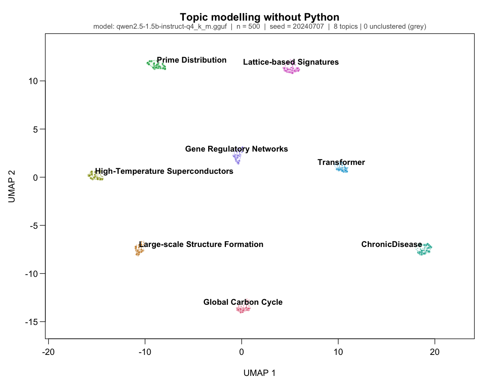

# relm

<!-- badges: start -->
[](https://github.com/Vadale/R-ebirth/actions/workflows/R-CMD-check.yaml)
[](https://vadale.r-universe.dev/relm)
[](https://github.com/Vadale/R-ebirth/blob/main/docs/api-policy.md)
[](https://github.com/Vadale/R-ebirth/blob/main/LICENSE.md)
<!-- badges: end -->

**Local models. Inspectable experiments. Ordinary R.**

relm runs open-weight models on your machine with no Python, model server or
API key. Generate text and constrained JSON, embed documents, and inspect a
model's internal values using ordinary R vectors, data frames and matrices.
Its Rust core embeds a pinned, patched llama.cpp; R remains your working
environment for statistics, visualization and reproducible research.

**Version 0.4.0** adds the complete research workflow: background generation,
token events, live observations, recorded directions, component projections and
base-R graphics, with code and trace-validation maintenance. See the
[release notes](https://github.com/Vadale/R-ebirth/blob/main/rebirth/NEWS.md#relm-040).
The [0.4.0 release](https://github.com/Vadale/R-ebirth/releases/tag/v0.4.0)
is published, including a verified fresh Mac arm64 r-universe installation.
Check `packageVersion("relm")` and restart R after upgrading.

The **0.5.0 source has been submitted to CRAN**, combining optional Linux CUDA
and source portability. A separate GitHub release and CRAN acceptance are pending; see the
[submission status](https://github.com/Vadale/R-ebirth/blob/main/docs/cran-submission.md).

## Installation

Use [r-universe](https://vadale.r-universe.dev/relm) and check the builds available
for your OS, R version and architecture:

```r
install.packages(
  "relm",
  repos = c("https://vadale.r-universe.dev", getOption("repos"))
)
packageVersion("relm")
```

r-universe tracks `main`; check the version before using the 0.4.0 research features.
Prebuilt binaries need no native toolchain. Source installation needs R >= 4.5,
Cargo >= 1.85.0 and rustc >= 1.85.0 (checked separately), CMake >= 3.28,
`xz` and a C/C++ compiler. See the
[installation guide](https://github.com/Vadale/R-ebirth/blob/main/docs/getting-started.md)
for source builds and troubleshooting. Development source additionally supports an
[explicit Linux CUDA build](https://github.com/Vadale/R-ebirth/blob/main/docs/linux-cuda.md);
an ordinary binary does not establish CUDA capability. Windows CPU source-package
and corrected 0.5.0 win-builder checks passed; Windows GPU and full live-file
lifecycle parity remain unverified.

Core imports are `methods` (included with R) and `nanoarrow`, which reads spilled traces.
`glmnet` is optional for probes; `uwot` and `dbscan` are optional demo packages.
Optional `later` and `promises` enable async/streaming generation.
Application examples prepare their own separate dependency environments.

## Quickstart

The small Qwen model below is approximately 675 MB. `llm_download()` verifies
the pinned Apache-2.0 model by SHA256 and reuses a matching cached copy.
For another model, see [choosing and changing models](https://github.com/Vadale/R-ebirth/blob/main/docs/models.md):
registry aliases, your own local GGUF, matched vision projectors and operation limits.

```r
library(relm)

path <- llm_download("qwen2.5-0.5b-instruct-q8_0")
m <- llm(path)

llm_generate(m, "The capital of France is", chat = FALSE,
             max_tokens = 8, temperature = 0)

# Embeddings are numerical representations of text: one matrix row per input.
emb <- llm_embed(m, c("cats", "kittens", "quarterly revenue"))
tcrossprod(emb)  # cosine similarities between normalized rows

# Activations are the numerical values inside the model at a selected layer.
tr <- llm_trace(m, "The movie was wonderful.",
                layers = 12, positions = "last", components = "residual")
as.matrix(tr, layer = 12, component = "residual")
```

`llm_tokens()` also converts text to token IDs, and `llm_logits()` returns the
next-token distribution as a data frame. Capture filters keep traces small;
traces over the configured budget spill to disk and are read a slice at a time.
The full 4B-model spill acceptance on a 16 GB Mac remains an open hardware check.

## Structured output

Pass JSON Schema text to the existing generation function. This example reuses
the model loaded above and returns a JSON string:

```r
schema <- '{
  "type": "object",
  "properties": {
    "sentiment": {"type": "string", "enum": ["positive", "negative"]}
  },
  "required": ["sentiment"],
  "additionalProperties": false
}'
llm_generate(m, 'Classify the sentiment of "I loved this film." Return JSON.',
             schema = schema, max_tokens = 64, temperature = 0)
close(m)
```

Successful calls return complete, validated JSON. Unsupported schemas fail
before generation; incomplete output raises a classed R condition. The supported
profile includes closed objects, bounded strings and integers, string enums,
booleans and null. Arrays, general JSON Schema, image inputs and nonempty stop
sequences are outside this mode. Schema validation establishes format, not
factual correctness. Ordinary text and image generation retain `schema = NULL`.

Spark-X2.5-4B is also supported natively through llama.cpp b10828. Its optional
`spark-x2.5-4b-q8_0` alias downloads the official 4.38 GB GGUF. Constrained chat
uses Spark's official non-thinking opener. **Spark activation tracing is
unsupported** until an independent numerical reference exists.

## A complete research experiment

The [research API guide](https://github.com/Vadale/R-ebirth/blob/main/docs/research-guide.md)
explains prompt traces, live observations and the data needed for comparisons.
The [complete walkthrough](https://github.com/Vadale/R-ebirth/blob/main/examples/research-workflow/README.md)
connects paired traces, recorded directions, original/zero/intervention controls,
text evaluation and CSV/RDS/plot export. It is a repository example: clone or
download the repository as well as installing relm.

A separate [first-use study](https://github.com/Vadale/R-ebirth/blob/main/docs/research-first-use.md)
records an agent's actual attempt with the released package. Its six calls
completed, but the small model invented facts in every response. Read that report
for practical difficulties and what was not tested; it is not external-human
usability validation.

### Streaming and live observations

`llm_generate(async = TRUE)` returns a promise while a native worker generates.
`on_token` receives data-frame batches of token/text events; `on_state` receives
bounded live observations. Optional `later >= 1.4.8` and `promises >= 1.5.0` are
required. In a noninteractive script, service the event loop until settlement.
Callbacks run on R's main thread and must remain short; `llm_cancel()` requests
cooperative cancellation. See the
[streaming guide](https://github.com/Vadale/R-ebirth/blob/main/rebirth/vignettes/token-streaming.qmd)
and the complete walkthrough for actual waiting and cleanup.

Ordinary `llm_trace()` observes a supplied prompt; it cannot trace an intervened
handle. To compare original and intervened generation, retain `on_state`
observations and pass them to `llm_compare()` with the recorded settings and
preceding sampled-token history. Live coefficient updates are additive;
component projection stays fixed for the derived handle. The
[support matrix](https://github.com/Vadale/R-ebirth/blob/main/docs/supported-workflow.md)
records the supported combinations.

## Investigate model behavior

`llm_probe()` fits binary ridge models to activation traces using a formula with
`activations()`. A probe asks how readily a label can be predicted from internal
model values. Explicit source groups keep related prompts together during
cross-validation; preprocessing and layer/regularization selection use development
data only. Reserve `test_groups` before analysis for held-out evaluation and
conditional group-bootstrap intervals. Without a holdout, results are labelled
exploratory and carry no inferential interval.

Use `summary()`, `plot()` and `predict()` on the fitted probe. The
[anatomy-lab vignette](https://github.com/Vadale/R-ebirth/blob/main/rebirth/vignettes/anatomy-lab.qmd)
explains grouped evaluation and saved-fit prediction. The complete
[probe evaluation script](https://github.com/Vadale/R-ebirth/blob/main/tests/demos/demo-probe-evaluation.R)
runs a paired-source example with paired-label and simple-feature controls.
Predictive decodability does not establish causal use.

For interventions, `llm_steer()` adds a chosen direction to the residual stream,
the values passed between model layers. `llm_ablate()` fixes selected units to a
value to investigate their effect. Both return a fresh model context over shared
weights; the original handle remains available for an exact reversal. A runtime
check refuses an intervention it cannot verify rather than silently doing nothing.
These are instruments to audit and investigate behavior, not guarantees of safety
or bias removal.

## Images and worked demos

Since 0.2.0, vision-language models accept JPEG, PNG and BMP inputs through
`llm_generate(images = ...)` and `llm_embed(images = ...)`. Load the model with
its companion `llm(projector = ...)`: the projector translates images into
values the language model can read. Interpretability of the vision encoder itself
is outside the current release.

Start with these worked demos using pinned Apache-2.0 models:

- **The anatomy lab:** activation traces, statistical probes and interventions.
  Open `vignette("anatomy-lab", package = "relm")`.
- **Topic modelling without Python:** embeddings, UMAP, HDBSCAN and model-generated
  cluster names. Open `vignette("topics-without-python", package = "relm")`.
- **Seeing machines:** generate test images, ask about them and compare image/text
  embeddings. Open `vignette("vision", package = "relm")`.



*Recorded Demo B output on 500 abstracts. The figure illustrates this corpus and
model run; it is not a general clustering-quality benchmark.*

## From an R session to a repeatable application

The repository includes two application templates, separate from the core API:

- [Restartable funding extraction](https://github.com/Vadale/R-ebirth/blob/main/examples/funding-extraction/README.md):
  explicit setup, offline execution, immutable results and verified resume.
- [Local funding service](https://github.com/Vadale/R-ebirth/blob/main/examples/funding-service/README.md):
  one loopback HTTP frontend, one persistent model worker, one active request,
  no job queue, durable tickets and recovery commands.

Their Mac/Linux operational acceptance includes interruption recovery and
1,000 same-worker service requests. Exact source provenance, limits and prior
failures remain in the
[service report](https://github.com/Vadale/R-ebirth/blob/main/docs/service-implementation.md).
Operational reliability does not establish extraction accuracy: the frozen D1
pilot had 10/10 schema-valid, 2/10 task-valid and 0/10 fully grounded records,
failing all four promotion gates. See the
[quality evaluation](https://github.com/Vadale/R-ebirth/blob/main/docs/d1-extraction-evaluation.md).

## Validation and license

The [validation ledger](https://github.com/Vadale/R-ebirth/blob/main/docs/validation-status.md)
distinguishes independent numerical references, regression checks and open
hardware/research gates. The
[architecture](https://github.com/Vadale/R-ebirth/blob/main/ARCHITECTURE.md) and
[decisions](https://github.com/Vadale/R-ebirth/blob/main/DECISIONS.md) explain the
native engine and its boundaries.

Original code is **MIT OR Apache-2.0**. Vendored llama.cpp is MIT. Modified
redistributions must rename under the
[trademark policy](https://github.com/Vadale/R-ebirth/blob/main/TRADEMARK.md).

## Agent documentation and compatibility

Start with the [agent guide](https://github.com/Vadale/R-ebirth/blob/main/docs/agents.md),
[llms.txt](https://github.com/Vadale/R-ebirth/blob/main/llms.txt) and the
[API/version policy](https://github.com/Vadale/R-ebirth/blob/main/docs/api-policy.md).
The WP16 build includes sixteen independent R example scripts under
`system.file("examples", "agents", package = "relm")`. Sourcing a script defines
its example; it never downloads a model or starts inference automatically.

The public API baseline includes the current exports and registered S3 methods.
The project's thirty-day green-CI gate precedes a future 1.0 release; CRAN admission
and external-human usability are separate outcomes.
